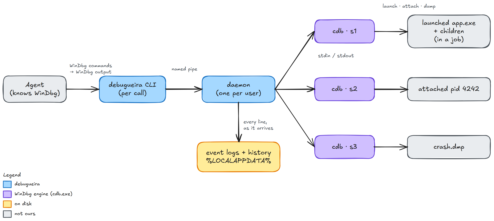

# debugueira

A WinDbg session manager for agents. **Many live cdb sessions at once, raw WinDbg commands in, WinDbg's own output out, and every line logged** so an agent can search it instead of reading it all.

<p align="center">
  <picture>
    <source media="(prefers-color-scheme: dark)" srcset="docs/images/architecture_darkmode.png">
    
  </picture>
</p>

> *Debugueira* is a Portuguese-flavored word: "-eira" is both a household machine (*torradeira*, a toaster) and a whole lot of something (*choradeira*, a crying fit). A debugging machine, and a debugging spree.

## Why

An agent driving a debugger through one-shot shell calls loses the session between calls, floods its context with module loads and banners, and leaves processes suspended when it forgets to clean up. debugueira fixes those three things:

- **Sessions outlive tool calls.** A per-user daemon keeps each cdb alive between commands.
- **Output stays small.** Replies are trimmed, noise is dropped, and everything else is one `grep`, `log --cmd N` or `query` away.
- **Nothing lingers.** Idle sessions end on their own, launched process trees die with their session, attached processes are always detached, and the daemon exits when it's idle.

It's a CLI, not an MCP server: the agent already knows WinDbg, so it types WinDbg.

## Install

1. **WinDbg** (for its `cdb`): `winget install Microsoft.WinDbg`. The Windows SDK debuggers work too.
2. **debugueira:** run `debugueira-<version>-setup.exe` from the [releases](https://github.com/cristeigabriela/debugueira/releases). It installs per user (no admin) and adds itself to your PATH. Open a new terminal afterwards.
3. **The agent skill:** the installer offers it, or run `debugueira skill install` (into `~/.claude/skills/debugueira`; `--path DIR` for other agents).

The installer is unsigned, so SmartScreen warns on first run.

From source: `uv sync`, then `uv run debugueira ...`.

## Thirty seconds

```
> debugueira start --name c -- crash.exe
...
ntdll!LdrpDoDebuggerBreak+0x35:
00007ff9`64b226c9 cc              int     3
[c · stopped at 0:000> · pid 22324 (0x5734)]

> debugueira cmd c g
about to crash
(5734.1ef4): Access violation - code c0000005 (first chance)
First chance exceptions are reported before any exception handling.
This exception may be expected and handled.
crash!parse_header+0xa:
00007ff7`bda6100a 8b00            mov     eax,dword ptr [rax] ds:00000000`00000000=????????
[c · stopped at 0:000> · access violation (first chance) · cmd #1]

> debugueira cmd c "k 2; dv /t"
Child-SP          RetAddr               Call Site
000000f7`1b9ff948 00007ff7`bda61054     crash!parse_header+0xa [D:\dev\debugueira\tests\targets\crash.c @ 18]
000000f7`1b9ff950 00007ff7`bda61449     crash!main+0x34 [D:\dev\debugueira\tests\targets\crash.c @ 29]
struct ctx * c = 0x00000000`00000000
[c · stopped at 0:000> · cmd #2]

> debugueira stop c
[c · ended · target killed (pid 22324)]
```

## What it does

| Area | Commands |
|---|---|
| **Sessions** | `start -- app.exe args`, `attach --pid N`, `open crash.dmp`, `stop`, `list`, `status`, and one-shot `peek --pid N "cmd"` |
| **Driving cdb** | `cmd NAME "any windbg line"`, `wait [--for REGEX]`, `break`, `input` (the target's stdin) |
| **Reading without flooding** | `log --cmd N`, `grep REGEX -C 2`, `new`, `query 'python'` |
| **Child processes** | followed by default; `--children none` or `"worker*.exe"`, `--break-on-child`, `procs` |
| **History** | `history`, `history show ID`, `note`, and `log`/`grep`/`query` on finished sessions |
| **Watching** | `watch` (a terminal UI over live sessions), `events` (what the daemon did: sessions and processes starting and ending) |
| **Housekeeping** | `doctor`, `gc`, `daemon status`/`stop` |

`query` runs a short Python snippet in the CLI and prints only what it prints, so an agent can compute an answer from WinDbg output instead of reading all of it:

```
debugueira query s1 "print(s.cmd('lm').grep('export symbols'))"
```

Native targets with PDBs and .NET targets (SOS loads on its own) both work. The full agent-facing manual is [`SKILL.md`](src/debugueira/skill/SKILL.md).

## How it works

- **The CLI** is short-lived: it asks the daemon over a named pipe that only the current user can open, prints, and exits.
- **The daemon** owns every session. It starts on the first command, outside the caller's job object, and exits after 10 idle minutes with no sessions.
- **Launched targets** are created suspended, with no window and pipes of their own, inside a kill-on-close job. cdb then attaches with `-pb -pr`. That gives clean tree cleanup, a real stdin for `input`, and no console windows.
- **Attached targets** get `-pd`, so they survive even if the daemon is killed.
- **Each session** writes `events.jsonl` (every command, every chunk of output, every event) and `meta.json` under `%LOCALAPPDATA%\debugueira\sessions\`. History is those folders. They're pruned after 90 days or 2 GB.
- **The daemon** also keeps one journal across all sessions, for people: `debugueira events` reads it, `debugueira watch` shows it live. Colored output appears only at a real terminal, never in an agent's pipe.
- **`watch` shows what the programs print,** in their own colors: every session and both streams by default, with `err` marked in words. `s` narrows to stdout or stderr, `o` to one session, `z` zooms the output to the whole screen. A target's children share its two pipes, so output can't be split by process. Many programs drop color when writing to a pipe; `--env FORCE_COLOR=1` or `--env CLICOLOR_FORCE=1` brings it back for many.

Settings live in `%LOCALAPPDATA%\debugueira\config.toml` (all optional): `cdb_path`, `idle_minutes`, `idle_cap_hours`, `daemon_idle_minutes`, `retention_days`, `retention_gb`, `head_lines`, `tail_lines`, `symbol_path`.

`symbol_path` is a symbol path added to every session (after its own `--sym` and `_NT_SYMBOL_PATH`); it replaces the built-in Microsoft-server default. Point it at your WinDbg store and any build output so symbols resolve the same in both tools, e.g. `symbol_path = "srv*C:\\symbols*https://msdl.microsoft.com/download/symbols;D:\\build\\pdbs"`. With it unset, debugueira uses the Microsoft server, cached in `C:\symbols` when that folder exists so WinDbg and debugueira share downloads.

## Compared to mcp-windbg

[mcp-windbg](https://github.com/svnscha/mcp-windbg) is an MCP server that's great for dumps, kernel targets and `-remote` debug servers. debugueira is a CLI and skill aimed at live local debugging: it launches and attaches itself, follows child processes, keeps searchable logs and history, and cleans up after itself.

## Development

```
uv sync
uv run python tests/targets/build.py   # small C and .NET targets (needs MSVC and the .NET SDK)
uv run pytest
uv run ruff check && uv run ruff format --check
uv run python packaging/build.py       # dist/: installer, zip, SHA256SUMS (needs Inno Setup 6)
```

The integration tests drive real cdb against the targets in `tests/targets/`. CI runs everything on `windows-latest`, and a `v*` tag publishes a release.

## License

[Unlicense](LICENSE): public domain.
